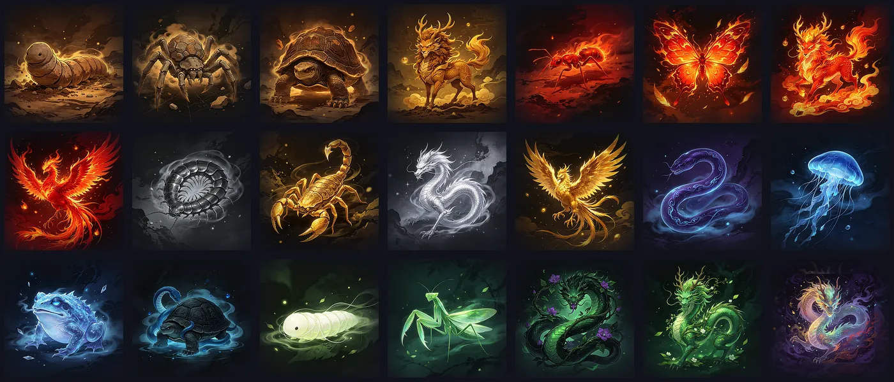

# 万蛊之王 · 养蛊小游戏

一个纯前端的修仙养蛊小游戏：孵化蛊虫、融合炼蛊、斗蛊争锋。**零依赖、零构建**，打开网页即玩。



## 玩法

- **孵化**（20 灵液）：随机得到一条蛊虫，属性、品质、天赋随机。神兽无法直接孵化。
- **融合**（10 灵液）：选中 **2 只**（**先点的是主蛊**）。成功率受品质、物种梯度、属性相性、天赋影响。
  - 成功 → 诞生更强的后代，同属同阶可**晋阶**，两只神兽相融可得**混沌蛊**
  - 失败 → **主蛊存活但属性下降，副蛊消散**
- **安抚**（灵液）：恢复忠心。蛊虫败北会掉忠心，忠心过低可能**反叛离巢**。
- **斗蛊**：选中 **1 只**出战。每回合**卜卦**预测对手阵眼，猜中者先手且有伤害加成。

## 核心系统

| 系统 | 说明 |
|---|---|
| **五行克制** | 金克木、木克土、土克水、水克火、火克金。克制 ×1.5，被克 ×0.65 |
| **物种梯度** | 21 个物种，每属性 4 阶（凡虫 → 灵虫 → 古兽 → 神兽）＋ 混沌蛊。越高阶越难融合 |
| **品质** | 凡品 → 良品 → 精品 → 绝品 → 灵品 → 仙品。**品质越高，融合越容易失败**（满品质约 −11 个百分点） |
| **天赋** | 8 种（毒煞／铁甲／疾风／通灵／不灭／化形／纯阳／天机），可觉醒、可遗传、可突变 |
| **忠心度** | 败北掉忠心，低于 30 时每场败仗有反叛概率（最高 36%）。纯阳天赋抗反叛 |
| **不败信念** | 连胜累积，每胜 +6% 属性，10 连胜封顶 +60%。**一败清零**；低忠心会削弱它 |

## 本地运行

图片是相对路径引用，直接双击 `index.html` 即可，不需要服务器。

如果想用本地服务器（更接近线上环境）：

```bash
python -m http.server 8000
# 然后打开 http://localhost:8000
```

## 目录结构

```
.
├── index.html              # 游戏主文件（GitHub Pages 入口）
├── assets/gu/              # 21 只蛊虫立绘
│   ├── <id>.webp           #   512px，用于卡片与战斗
│   └── sm_<id>.webp        #   160px，用于图鉴缩略
├── build_game.py           # 生成器（改数值/加物种改这里）
└── README.md
```

`<id>` 为物种编号：`金` 用 `m`、`木` 用 `w`、`水` 用 `s`、`火` 用 `f`、`土` 用 `e`，混沌蛊为 `x7`。

> 立绘用 WebP 存储（比 PNG 小约 7 倍），全站总计约 1.8 MB。所有现代浏览器均支持。

## 部署到 GitHub Pages

1. 新建一个公开仓库，把本目录**所有文件**（含 `.nojekyll` 和 `assets/`）上传到仓库根目录
2. 仓库 **Settings → Pages**
3. **Source** 选 `Deploy from a branch`，**Branch** 选 `main`、目录选 `/ (root)`，保存
4. 等 1–2 分钟，访问 `https://<你的用户名>.github.io/<仓库名>/`

`.nojekyll` 不能删——它阻止 GitHub 用 Jekyll 处理站点，否则可能漏掉资源文件。

## 二次开发

游戏本体是**单文件** `index.html`，内联了全部 CSS 与 JS，可直接编辑。

如果要用生成器（推荐，改数值不易出错）：编辑 `build_game.py` 里的数据表，然后

```bash
python build_game.py     # 重新生成 HTML
```

常改的几处：

- `SPECIES` —— 物种名／属性／梯度／出现权重
- `ELEM_ADV` / `ELEM_DIS` —— 克制倍率
- `fuseChance()` —— 融合成功率公式
- `TALENTS` —— 天赋效果
- `USE_IMAGES` —— 开关立绘，关掉则回退内置程序化 SVG

## 授权

- **代码**：可自由使用、修改、分发。
- **美术**：21 张蛊虫立绘由第三方图像生成工具产出，随本项目一同提供；如需商用请自行确认生成工具的使用条款。
